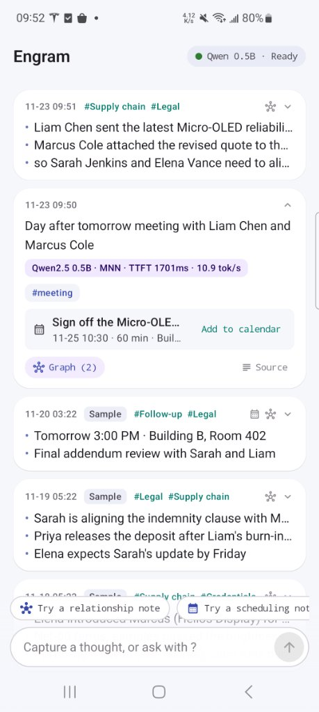
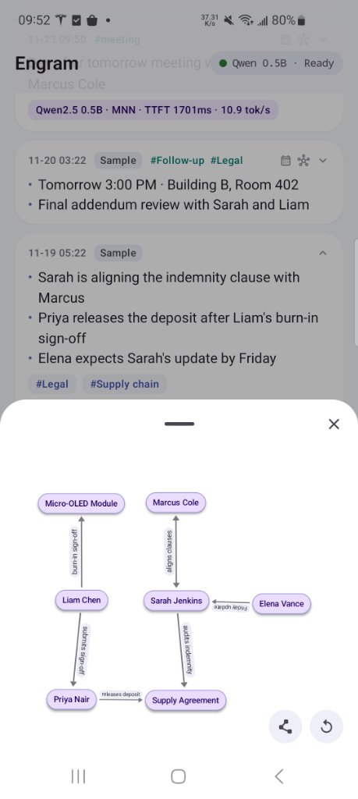
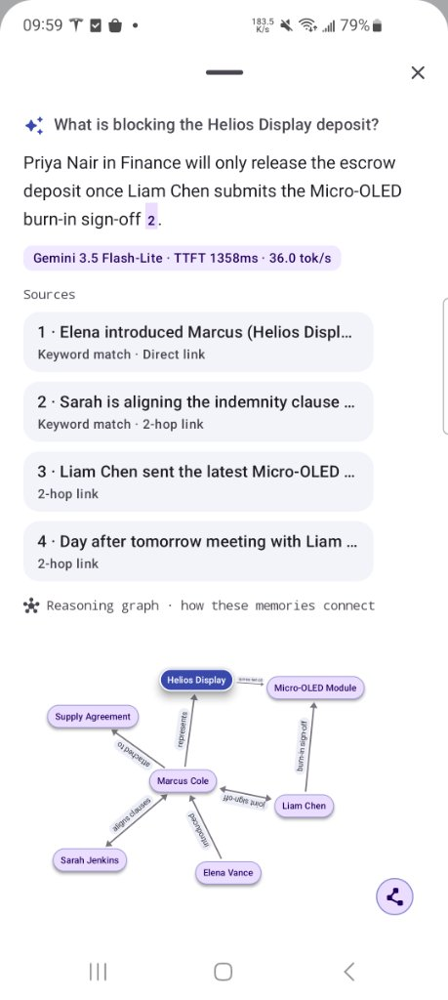
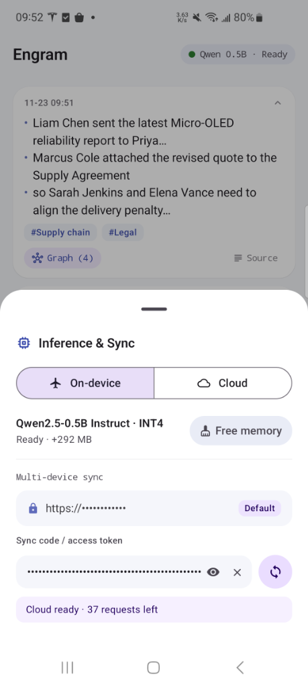
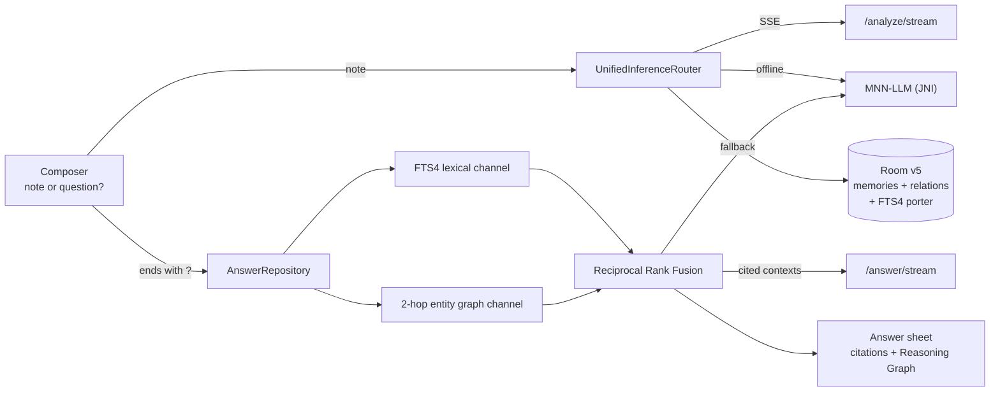

# Engram

<p align="start">
  <a href="README_zh.md"><b>中文说明</b></a>
</p>

> **Privacy-first, on-device AI memory with a 2D relationship graph.**
> Engram turns quick notes into verifiable memories — bullet summaries, calendar proposals, and relation triples — with Alibaba MNN running Qwen2.5-0.5B offline, optional Gemini streaming in the cloud, and on-device GraphRAG to ask questions across everything you have captured. One AI-native monorepo: Android (Kotlin/Compose), C++/JNI runtime, FastAPI gateway, and shared JSON Schema contracts.

> Measured on Samsung Galaxy F52 5G (Snapdragon 750G): on-device MNN Qwen2.5-0.5B INT4 reaches **TTFT ≈ 1.6 s · 14–20 tok/s · +290 MB RSS**; cloud Gemini Flash-Lite streams at **TTFT < 1 s**. See the [benchmark matrix](docs/benchmark.md#3-real-device-mnn-llm-benchmark-matrix).

<p align="center">
  
  
  
  
</p>
<p align="center">
  <sub><b>1.</b> Capture timeline &amp; MNN telemetry &nbsp;·&nbsp; <b>2.</b> Deponder 2D relationship graph &nbsp;·&nbsp; <b>3.</b> Cited GraphRAG &amp; unfolded reasoning graph &nbsp;·&nbsp; <b>4.</b> On-device RSS &amp; cloud sync</sub>
</p>

---

## Highlights

### Capture → distill, streamed like a typewriter
- One single-screen Material 3 Expressive workspace: a titleless timeline and one symmetrical composer. No tabs, no mode switches.
- A note is distilled by the cloud gateway (Gemini via Vertex AI, SSE), or on-device by MNN when offline. While the model is still emitting JSON, an incremental parser (`PartialJsonSummaryExtractor`) extracts the `summary` field and types it out as real bullets. Raw JSON never reaches the UI.
- Every card shows the engine that actually produced it (`Gemini 3.5 Flash-Lite · TTFT 899ms · 103.9 tok/s`, `Qwen2.5 0.5B · MNN · …`, `Cloud fallback · …`). Nothing is faked: unready offline models are gated before send, while unauthenticated or offline cloud runs without an on-device model state the reason and use deterministic local extraction.

### Ask your memories — on-device GraphRAG with zero extra UI
- End a note with **`?`** (or **`？`**) and the send arrow morphs into a sparkle. The question is answered, never saved.
- **Retrieval** fuses two orthogonal channels with **Reciprocal Rank Fusion**:
  - **Lexical:** Room **FTS4 with SQLite's `porter` stemmer** (`quoting` matches `quoted`) as an external-content index kept in sync by Room triggers, paired with CJK 2-gram segmentation and bounded 1-edit typo fallback.
  - **Graph:** entities named in the question seed a **2-hop breadth-first walk** over the entity graph built from every memory's relation triples. It surfaces notes that never contain the query words: ask about *Helios Display* and the finance blocker in another note is found through `Helios Display — Micro-OLED Module — Liam Chen`.
- **Answer sheet:** a cited answer streams in, with `[n]` rendered as tappable chips that open the source. Below it are source chips (*Keyword match · 2-hop link*) and an inline **Reasoning Graph**: the walked cross-memory subgraph on a live Deponder physics canvas, with question entities highlighted.
- **Honest fallback chain:** cloud → on-device MNN → retrieval-only (*"No model loaded · Showing matched memories"*). It never fabricates an answer.

### Relationship graph (Deponder 0.6.0)
- Per-memory frameless graph sheet (50% ↔ 92%) with content-adaptive spring lengths, serpentine linear-chain viewport containment, opt-in `Unfold` topological untangling (space-adaptive icon/label pills), canvas-drag isolation from sheet dismissal, and `Δheight / 2` recentering.

### Edge runtime (`:packages:edge-mnn`)
- Every JNI call is confined to a single `mnn-jni-serial` dispatcher guarded by a `Mutex`.
- Decoding is step-cancelable (`Llm::generate(1)`), and tokens pass through a 32 ms coalescing window before reaching the UI.
- Native libraries use 16 KB ELF page alignment.
- Process RSS is tracked via `/proc/self/statm`, and `onTrimMemory` unloads the model.
- The engine refuses to report `Ready` without real `libMNN.so` and verified weights.

### Cloud gateway (`server/`)
- FastAPI service with Vertex AI `gemini-3.5-flash-lite` (`google-genai`, `location="global"`) or any OpenAI-compatible upstream.
- **Endpoints:** `POST /api/v1/analyze/stream` (distillation), `POST /api/v1/answer/stream` (cited GraphRAG answers), `POST /api/v1/memories/sync` and `/delete` (multi-device last-write-wins sync with tombstones), and `GET /api/v1/auth/status` (zero-cost session probe).
- **Access control:** stateless 7-day HMAC Bearer tokens, plus an atomic per-token and monthly spend ledger that refunds failures before the stream starts.
- **Default gateway on the client:** the URL is encrypted at build time with AES-256-GCM from `local.properties`, so neither Git nor the DEX contains it in plaintext.

### Contract-first
- `contracts/*.schema.json` (Draft 2020-12) is the single source of truth for Kotlin DTOs and Pydantic models. Server tests validate every payload and SSE frame against it.

---

## Architecture



Full state machines and invariants: [docs/architecture.md](docs/architecture.md).

---

## Repository Structure

```text
engram/
├── AGENTS.md                       # Engineering charter & invariants (source of truth)
├── CLAUDE.md                       # Quick command reference
├── .cursor/rules/                  # Path-scoped engineering constraints (.mdc)
├── contracts/                      # Shared JSON Schemas (Draft 2020-12)
├── app/                            # :app Android client (Compose + Nav3 + Koin + Stream MVI + Room)
├── packages/edge-mnn/              # :packages:edge-mnn C++/JNI MNN runtime & RSS lifecycle guard
├── server/                         # FastAPI gateway (Vertex AI SSE, answers, sync, quota)
├── scripts/                        # MNN Android build, model download, dev server
└── docs/                           # Architecture & benchmarks
```

---

## Quick Start

### 1. Install the prebuilt APK (fastest)

Download the signed `arm64-v8a` APK from **[GitHub Releases](https://github.com/cinpeCan/Engram/releases/latest)** (`libMNN.so` and `libllm.so` are prebundled; Android 10+):
- Open the app to explore the sample memories and 2D relationship graphs right away.
- Tap the top-right engine chip (`Inference & Sync`) to download **`Qwen2.5-0.5B-Instruct-MNN`** inside the app for offline distillation and GraphRAG, or enter an access token to stream via the cloud gateway.

### 2. Build from source

```bash
# Optional: build alibaba/MNN arm64-v8a shared libraries (NDK 28, 16 KB page alignment)
./scripts/build_mnn_android.sh
```

Then run the unit tests and assemble the debug APK (`:packages:edge-mnn` compiles with `ENGRAM_HAS_MNN_LIB=1` once `jniLibs/arm64-v8a/` is populated, or with `ENGRAM_HAS_MNN_LIB=0` out of the box):

```bash
./gradlew testDebugUnitTest assembleDebug
```

You can also push `Qwen2.5-0.5B-Instruct-MNN` weights over ADB:

```bash
python3 scripts/fetch_models.py --adb-push
```

### 3. Run the gateway locally

```bash
# http://0.0.0.0:8787 (USB debugging: adb reverse tcp:8787 tcp:8787)
./scripts/dev_server.sh

# Contract tests against contracts/*.schema.json
server/.venv/bin/pytest server/tests
```

---

## Documentation

- [System Architecture & State Machines](docs/architecture.md)
- [On-Device MNN Benchmark Guide](docs/benchmark.md)

---

## License

Copyright © 2026 Can Huang. **All rights reserved.**

This repository is published as a source-available portfolio for technical review only. You may view and build the source to evaluate it. Copying, modifying, redistributing, sublicensing, or using any part of it in commercial or production software requires prior written permission. No open-source license is granted. See [LICENSE](LICENSE) for the full terms.

### Third-Party Components

Third-party components keep their own licenses and are **not** covered by the notice above:

| Component | Usage | License |
| :--- | :--- | :--- |
| [Alibaba MNN](https://github.com/alibaba/MNN) | On-device LLM runtime, built locally via `scripts/build_mnn_android.sh` (not vendored) | Apache-2.0 |
| [Qwen2.5-0.5B-Instruct-MNN](https://modelscope.cn/models/MNN/Qwen2.5-0.5B-Instruct-MNN) | Quantized weights, downloaded at runtime from ModelScope / HuggingFace (not vendored) | Apache-2.0 |
| [Deponder](https://github.com/cinpeCan/Deponder) | 2D force-directed graph physics (`io.github.cinpecan:deponder-compose`) | Apache-2.0 |
| AndroidX, Kotlin, Koin, OkHttp, Robolectric, FastAPI, `google-genai` | Maven Central / PyPI dependencies | Respective upstream licenses |
