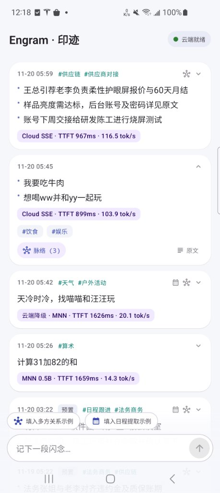
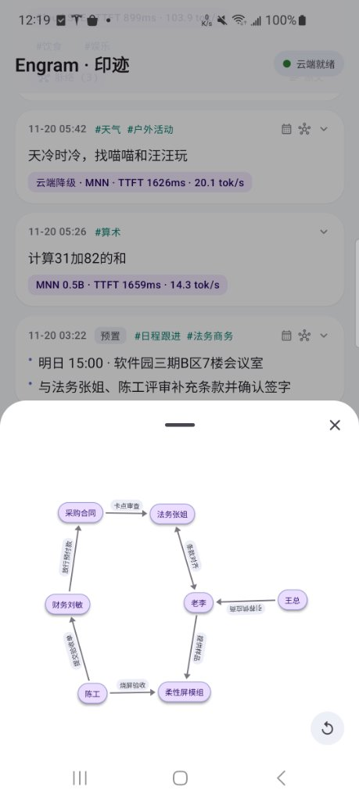
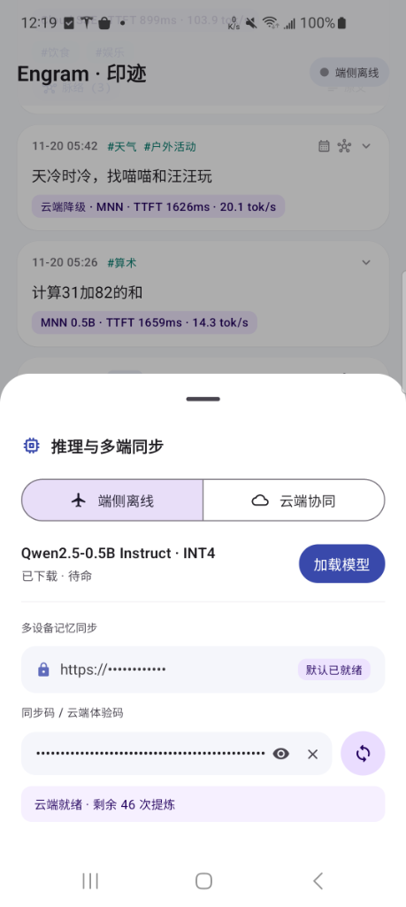

# Engram (印迹)

> **Privacy-First On-Device AI Memory & 2D Directed Relationship Workspace**  
> Built as an AI-Native Monorepo combining **Alibaba MNN Edge Inference**, **Cloud SSE Structured Distillation**, **Human-in-the-Loop System Tools**, and **[Deponder 0.6.0](https://github.com/cinpeCan/Deponder)** 2D Physics Graphs inside a single-screen Material 3 workspace.

<p align="center">
  
  &nbsp;
  
  &nbsp;
  
</p>

<p align="center"><sub>Timeline with per-card engine telemetry · Deponder relationship graph · Inference & sync sheet</sub></p>

> Measured on Samsung Galaxy F52 5G (Snapdragon 750G): on-device MNN Qwen2.5-0.5B INT4 reaches **TTFT ≈ 1.6 s · 14–20 tok/s · +290 MB RSS**; cloud Gemini Flash-Lite streams at **TTFT < 1 s**. See the [benchmark matrix](docs/benchmark.md#3-real-device-mnn-llm-benchmark-matrix).

---

## Core Architecture Highlights

- **Monorepo & Contract-First (`contracts/`)**: Shared JSON Schemas (`memory-analysis`, `analysis-sse`, `memory-sync`) align the Kotlin Android client, `:packages:edge-mnn` C++/JNI runtime, and Python `FastAPI` service from a single source of truth, reinforced by root `AGENTS.md` and `.cursor/rules/*.mdc`.
- **Single-Screen Material 3 Expressive Workspace & De-emphasized Raw Storage**:
  - Focused titleless `CaptureScreen` timeline with scroll-collapsing symmetrical input bar enclosing an optically centered `ArrowUpward` action, M3 Expressive spring shape-morphing surfaces & low-glare ripples, tap/scroll IME dismissal, and zero double window insets.
  - Newly captured memories stream real coalesced deltas in-place during `PENDING` state, then converge via `AnimatedContent` (with subtle haptic feedback) to scannable bulleted summaries, tags, `CalendarContract` confirmation strips, honest model-driven telemetry badges (`MNN 0.5B` / `Cloud SSE`) or a subtle `"预置"` origin badge on seed items, and a low-emphasis expanded-card `原文` entry opening `RawMemoryBottomSheet`.
  - Long-pressing any card opens a floating contextual delete bubble backed by a transient `Snackbar` undo window and Room `deleted_memories` tombstones to prevent stale remote resurrection during multi-device sync.
- **Single-Memory Frameless 2D Graph Sheet (`Deponder 0.6.0`)**:
  - `BottomSheetSceneStrategy(expandable = true)` renders `GraphSheet(memoryId)` as a clean frameless half-height (`50%`) to full-height (`92%`) stretchable Material 3 `ModalBottomSheet` with a top handle/close bar, sibling canvas gesture isolation so `deponderDrag()` never triggers sheet dismissal, and automatic `Δheight / 2` vertical recentering across sheet transitions.
  - Supports **Streaming Growth Replay** and node-tap entity memory citations from Room (`memories` + `memory_relations`).
- **Koin 4.2 + Navigation 3 + Fine-Grained Stream MVI**:
  - Uses official Koin-Nav3 integration (`koin-compose-navigation3` `navigation<T>` + `koinEntryProvider()`), per-entry `ViewModelStore` scoping (`rememberViewModelStoreNavEntryDecorator()`), and `BottomSheetSceneStrategy` overlays (`GraphSheet`, `RawMemorySheet`, & `EngineSheet`).
  - Decouples high-frequency text inputs and streaming previews from low-frequency controls into specific `StateFlow` streams, driven by sealed `Intent`s and `Channel`-backed one-shot `Effect`s.
- **Zero-Stub Native Lifecycle & Memory Safety (`:packages:edge-mnn`)**:
  - Confines every JNI session call onto a single dedicated `mnn-jni-serial` coroutine dispatcher guarded by `Mutex`.
  - Refuses to enter `EngineState.Ready` without real `libMNN.so` / `libllm.so` and verified model weights on disk; runs a step-cancelable `Llm::generate(1)` decode loop piped through a **32ms tumbling window** (`TokenStreamCoalescer`).
  - Tracks process resident memory (RSS via `/proc/self/statm`), enforces **16KB ELF page-size alignment** (`-Wl,-z,max-page-size=16384`), and implements `ComponentCallbacks2.onTrimMemory` unloading (`Unloaded -> Loading -> Ready -> Generating -> Releasing`).
- **Direct Open-Source Model Fetching, Multi-Device Sync & Quota-Guarded Cloud SSE**:
  - `EngineBottomSheet` fetches `Qwen2.5-0.5B-Instruct-MNN` directly from ModelScope (with automatic HuggingFace mirror fallback) using `OkHttp Range + RandomAccessFile` and SHA-256 verification.
  - Supports build-time AES-256-GCM masked default gateway injection (`local.properties` -> `DefaultCloudEndpointProvider`) with optional custom endpoint override, masked `Authorization: Bearer` token input verified reactively by `CloudSessionMonitor`, and SQLite-backed multi-device LWW sync + tombstone deletion (`POST /api/v1/memories/sync`, `POST /api/v1/memories/delete`).
  - The same-repo `FastAPI` service verifies stateless 7-day HMAC Bearer tokens (`GET /api/v1/auth/status`), enforces atomic per-token & monthly spend caps in `demo_quota_ledger` (refunding pre-stream failures), and streams Vertex AI Gemini (`google-genai`) or OpenAI-compatible SSE distillation (`POST /api/v1/analyze/stream`).

---

## Repository Structure

```text
engram/
├── AGENTS.md                       # Global AI-native engineering charter & invariants
├── CLAUDE.md                       # Quick command reference
├── .cursor/rules/                  # Path-scoped engineering constraints (.mdc)
├── contracts/                      # Shared JSON Schemas (Draft 2020-12)
│   ├── memory-analysis.schema.json
│   ├── analysis-sse.schema.json
│   └── memory-sync.schema.json
├── app/                            # :app Android client (Compose + Nav3 + Koin + Stream MVI + Room)
├── packages/
│   └── edge-mnn/                   # :packages:edge-mnn C++/JNI MNN runtime & RSS lifecycle guard
├── server/                         # Python FastAPI service (multi-device SQLite sync & cloud SSE)
├── scripts/                        # MNN Android build, direct model download, and dev server scripts
└── docs/                           # Architecture specification & benchmark guide
```

---

## Quick Start

### 1. Build Bundled MNN Native Libraries (Recommended for Real-Device Inference)

```bash
# Build alibaba/MNN arm64-v8a shared libraries with NDK 28 & 16KB page-size alignment
./scripts/build_mnn_android.sh
```

Then run tests & build the APK (`:packages:edge-mnn` compiles with `ENGRAM_HAS_MNN_LIB=1` once `jniLibs/arm64-v8a/` is populated, or `ENGRAM_HAS_MNN_LIB=0` out-of-the-box):

```bash
./gradlew testDebugUnitTest assembleDebug
```

Open the root directory directly in Android Studio and run `:app` on an emulator or `arm64-v8a` device. You can download `Qwen2.5-0.5B-Instruct-MNN` directly from ModelScope inside the app, or push via ADB:

```bash
# Fetch 4-bit Qwen2.5-0.5B MNN weights directly from ModelScope/HuggingFace and push to device
python3 scripts/fetch_models.py --adb-push
```

### 2. Run Multi-Device Sync & Cloud SSE Server

```bash
# Start server on http://0.0.0.0:8787 (for USB real-device debugging: adb reverse tcp:8787 tcp:8787)
./scripts/dev_server.sh

# Verify FastAPI endpoints against contracts/*.schema.json
server/.venv/bin/pytest server/tests
```

---

## Documentation

- [System Architecture & State Machines](docs/architecture.md)
- [On-Device MNN Benchmark Guide](docs/benchmark.md)

---

## License

Copyright © 2026 Can Huang. **All rights reserved.**

This repository is published as a source-available portfolio for technical review only. You may view and build the source to evaluate it. Copying, modifying, redistributing, sublicensing, or using any part of it in commercial or production software requires prior written permission. No open-source license is granted. See [LICENSE](LICENSE) for the full terms.

### Third-Party Components

Third-party components keep their own licenses and are **not** covered by the notice above:

| Component | Usage | License |
| :--- | :--- | :--- |
| [Alibaba MNN](https://github.com/alibaba/MNN) | On-device LLM runtime, built locally via `scripts/build_mnn_android.sh` (not vendored) | Apache-2.0 |
| [Qwen2.5-0.5B-Instruct-MNN](https://modelscope.cn/models/MNN/Qwen2.5-0.5B-Instruct-MNN) | Quantized weights, downloaded at runtime from ModelScope / HuggingFace (not vendored) | Apache-2.0 |
| [Deponder](https://github.com/cinpeCan/Deponder) | 2D force-directed graph physics (`io.github.cinpecan:deponder-compose`) | Apache-2.0 |
| AndroidX, Kotlin, Koin, OkHttp, FastAPI, `google-genai` | Maven Central / PyPI dependencies | Respective upstream licenses |
