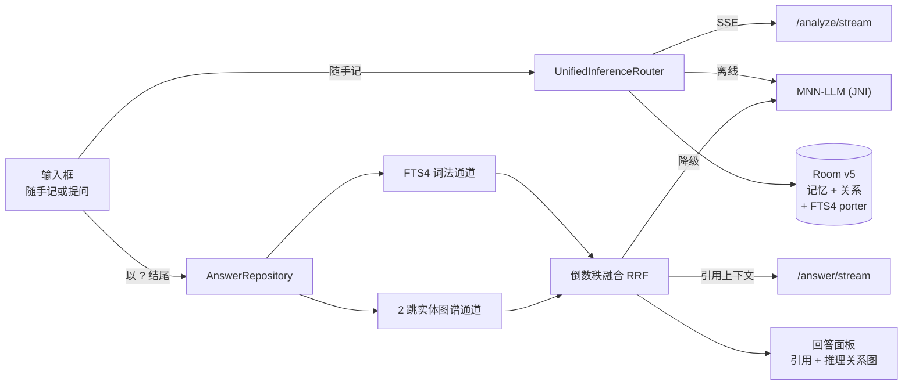

# Engram

<p align="start">
  <a href="README.md"><b>English</b></a>
</p>

> **隐私优先的端侧 AI 记忆应用，附带 2D 关系图谱。**
> Engram 把随手记提炼成可核验的记忆：分点摘要、日程提议和关系三元组。离线时由 Alibaba MNN 在本机运行 Qwen2.5-0.5B，联网时可选 Gemini 云端流式提炼；还能通过端侧 GraphRAG 跨全部记忆提问。整个项目是一个 AI 原生单仓：Android（Kotlin/Compose）、C++/JNI 推理运行时、FastAPI 网关，以及三端共享的 JSON Schema 契约。

> 真机实测（Samsung Galaxy F52 5G / Snapdragon 750G）：端侧 MNN Qwen2.5-0.5B INT4 **首字约 1.6 s、14–20 tok/s、内存增量 +290 MB**；云端 Gemini Flash-Lite **首字 < 1 s**。详见[基准测试](docs/benchmark.md#3-real-device-mnn-llm-benchmark-matrix)。

---

## 亮点

### 记录即提炼，摘要逐字流式呈现
- 单屏 Material 3 Expressive 工作区：一条无标题时间线，一个对称输入框。没有 Tab，也没有模式切换。
- 随手记优先交给云端网关提炼（Vertex AI Gemini，SSE 流式）；离线时交给端侧 MNN。模型还在输出 JSON 时，增量解析器（`PartialJsonSummaryExtractor`）就把 `summary` 字段实时提取出来，按正式分点逐字显示，界面上看不到原始 JSON。
- 每张卡片都标出实际生成它的引擎，例如 `Gemini 3.5 Flash-Lite · TTFT 899ms · 103.9 tok/s`、`Qwen2.5 0.5B · MNN · …`、`Cloud fallback · …`。不伪造状态：离线模型未就绪时会在发送前直接提示；云端缺少有效访问令牌且无端侧模型时，卡片会如实说明原因，并改用确定性的本地提炼。

### 向记忆提问：端侧 GraphRAG，不增加任何界面
- 输入内容以 **`?`**（或 **`？`**）结尾，发送箭头就变成星芒图标。这句话会被当作提问来回答，不会存成记忆。
- **检索**由两路互不重叠的通道组成，用 **RRF（倒数秩融合）** 合并排序：
  - **词法通道**：Room **FTS4 全文索引 + SQLite `porter` 词干分词**（搜 `quoting` 能命中 `quoted`），由外部内容表与 Room 触发器自动保持同步，并配合中文 2-gram 切分与 1 编辑距离拼写容错。
  - **图谱通道**：以问题里提到的实体为起点，在所有记忆的关系三元组构成的实体图上做 **2 跳广度优先遍历**。这样能找到根本不含查询词的记忆：问 *Helios Display*，会沿 `Helios Display — Micro-OLED Module — Liam Chen` 找到另一条记忆里的财务卡点。
- **回答面板**：带引用的回答流式输出，`[n]` 显示为可点击的小标签，点开即跳到原文。下方列出来源标签（*Keyword match · 2-hop link*），以及一张内嵌的**推理关系图（Reasoning Graph）**：用 Deponder 物理画布展示本次遍历的跨记忆子图，并高亮问题里的实体。
- **如实降级**：云端 → 端侧 MNN → 仅展示检索结果（*"No model loaded · Showing matched memories"*）。不会编造答案。

### 关系图谱（Deponder 0.6.0）
- 每条记忆一张无边框图谱面板（50% ↔ 92% 两档高度），支持按内容自适应的弹簧长度、长链蛇形首屏收束、按需触发的 `Unfold` 拓扑解结（随视口空间自适应切换纯图标与图文胶囊）、画布拖动与面板关闭手势隔离，以及高度变化时按 `Δheight / 2` 自动居中。

### 端侧运行时（`:packages:edge-mnn`）
- 所有 JNI 调用都限定在单线程 `mnn-jni-serial` 调度器上，并由 `Mutex` 保护。
- 逐 token 解码（`Llm::generate(1)`），可随时取消；token 先经 32 ms 窗口合并再推给 UI。
- 原生库按 16 KB ELF 页对齐。
- 通过 `/proc/self/statm` 追踪进程 RSS，并在 `onTrimMemory` 时释放模型。
- 没有真实的 `libMNN.so` 和校验通过的权重时，引擎不会报告 `Ready`。

### 云端网关（`server/`）
- FastAPI 服务，接入 Vertex AI `gemini-3.5-flash-lite`（`google-genai`，`location="global"`），也可接任意 OpenAI 兼容上游。
- **接口**：`POST /api/v1/analyze/stream`（提炼）、`POST /api/v1/answer/stream`（GraphRAG 引用回答）、`POST /api/v1/memories/sync` 与 `/delete`（多设备最后写入优先同步 + 删除墓碑）、`GET /api/v1/auth/status`（零成本会话探测）。
- **访问控制**：无状态 7 天 HMAC Bearer 访问令牌，配合原子化的单令牌次数与月度费用账本；建流前失败会自动退还额度。
- **客户端默认网关**：地址在编译期从 `local.properties` 读取，并用 AES-256-GCM 加密写入，Git 与 DEX 中都没有明文。

### 契约优先
- `contracts/*.schema.json`（Draft 2020-12）是 Kotlin DTO 与 Pydantic 模型的唯一来源。服务端测试会把每个请求体和 SSE 帧都对照它校验。

---

## 架构



完整状态机与工程约束见 [docs/architecture.md](docs/architecture.md)（英文）。

---

## 目录结构

```text
engram/
├── AGENTS.md                       # 工程规范与不变量（唯一权威来源）
├── CLAUDE.md                       # 常用命令速查
├── .cursor/rules/                  # 按路径生效的工程约束（.mdc）
├── contracts/                      # 三端共享 JSON Schema（Draft 2020-12）
├── app/                            # :app Android 客户端（Compose + Nav3 + Koin + Stream MVI + Room）
├── packages/edge-mnn/              # :packages:edge-mnn C++/JNI MNN 运行时与内存生命周期守护
├── server/                         # FastAPI 网关（Vertex AI SSE、引用回答、同步、额度）
├── scripts/                        # MNN 交叉编译、模型下载、本地服务脚本
└── docs/                           # 架构与基准测试文档
```

---

## 快速开始

### 1. 编译 MNN 原生库（真机端侧推理需要）

```bash
# 用 NDK 28 编译 alibaba/MNN arm64-v8a 动态库，16 KB 页对齐
./scripts/build_mnn_android.sh
```

然后运行测试并构建。`jniLibs/arm64-v8a/` 有原生库时，`:packages:edge-mnn` 以 `ENGRAM_HAS_MNN_LIB=1` 编译；没有时以 `ENGRAM_HAS_MNN_LIB=0` 直接编译通过：

```bash
./gradlew testDebugUnitTest assembleDebug
```

模型 `Qwen2.5-0.5B-Instruct-MNN` 可以在 App 内下载（魔搭优先，HuggingFace 备用），也可以通过 ADB 推送：

```bash
python3 scripts/fetch_models.py --adb-push
```

### 2. 启动网关

```bash
# 监听 http://0.0.0.0:8787（USB 真机调试：adb reverse tcp:8787 tcp:8787）
./scripts/dev_server.sh

# 对照 contracts/*.schema.json 运行契约测试
server/.venv/bin/pytest server/tests
```

---

## 文档

- [系统架构与状态机](docs/architecture.md)（英文）
- [端侧 MNN 基准测试](docs/benchmark.md)（英文）

---

## 许可

Copyright © 2026 Can Huang. **保留所有权利。**

本仓库仅作为源码公开的作品集，供技术评估使用。你可以浏览并在本地构建源码以评估其实现。未经事先书面许可，不得复制、修改、再分发、转授权，或将其任何部分用于商业或生产环境。本仓库不授予任何开源许可。完整条款见 [LICENSE](LICENSE)。

### 第三方组件

第三方组件沿用各自的许可，**不受**上述声明约束：

| 组件 | 用途 | 许可 |
| :--- | :--- | :--- |
| [Alibaba MNN](https://github.com/alibaba/MNN) | 端侧 LLM 运行时，通过 `scripts/build_mnn_android.sh` 在本地编译（未纳入仓库） | Apache-2.0 |
| [Qwen2.5-0.5B-Instruct-MNN](https://modelscope.cn/models/MNN/Qwen2.5-0.5B-Instruct-MNN) | 量化权重，运行时从魔搭 / HuggingFace 下载（未纳入仓库） | Apache-2.0 |
| [Deponder](https://github.com/cinpeCan/Deponder) | 2D 力导向图物理引擎（`io.github.cinpecan:deponder-compose`） | Apache-2.0 |
| AndroidX、Kotlin、Koin、OkHttp、Robolectric、FastAPI、`google-genai` | Maven Central / PyPI 依赖 | 各自上游许可 |
