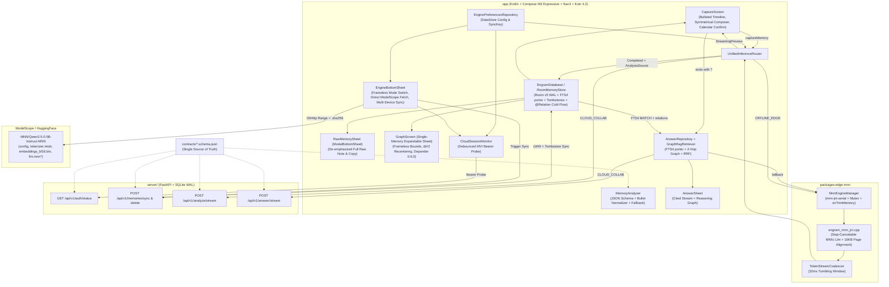
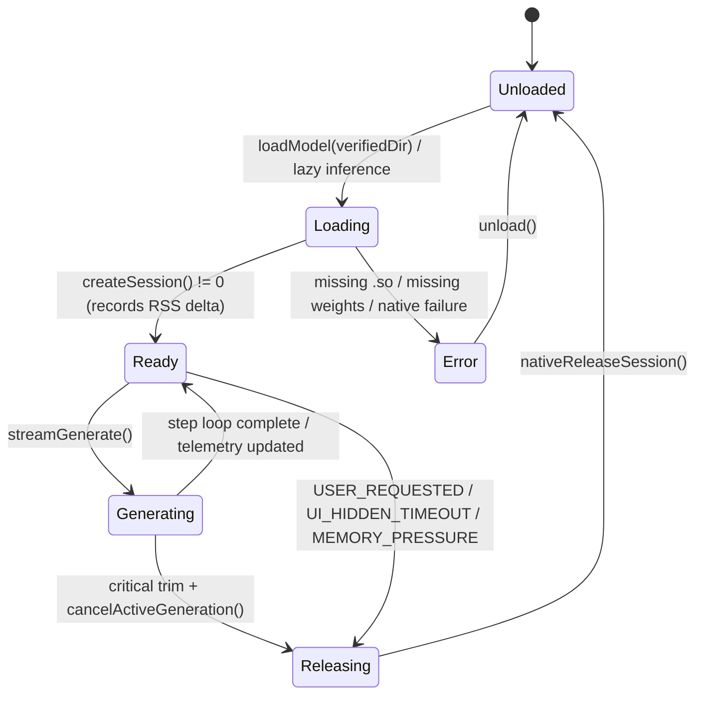
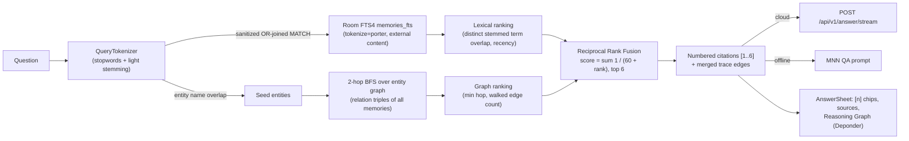

# Engram System Architecture

## 1. End-to-End Monorepo Data Flow

---

## 2. Edge Runtime Lifecycle & Native Memory State Machine

All calls to native handles execute sequentially on `mnn-jni-serial` protected by a Kotlin coroutine `Mutex`. Without prebuilt `libMNN.so` / `libllm.so` (`isBackendAvailable == false`) or verified local weights, `MnnEngineManager.loadModel` rejects the request with `EngineState.Error` instead of faking `Ready`. `EngramApplication.onTrimMemory` drives automatic background reclamation:

### Memory Accounting & Trim Policy
- **Process RSS (`AndroidMemoryProvider`)**: Reads `/proc/self/statm` resident pages multiplied by `Os.sysconf(_SC_PAGESIZE)` so `MNN_LOW_MEMORY` `mmap`-backed weights are reflected accurately on both 4KB and 16KB page-size devices.
- **`TRIM_MEMORY_UI_HIDDEN (20)`**: Schedules deferred `unload(UI_HIDDEN_TIMEOUT)` after `15s` grace window; cancelled automatically if the user resumes inference.
- **`TRIM_MEMORY_RUNNING_CRITICAL (15)`** or **`level >= TRIM_MEMORY_BACKGROUND (40)`**: Immediately sets `cancel_requested` (halting `Llm::generate(1)` on the next token step) and dispatches `unload(MEMORY_PRESSURE)`.

---

## 3. Single-Memory Frameless Sheet, Gesture Isolation & Deponder 0.6.0 Invariants

1. **Two-Stage Frameless `GraphSheet` (`BottomSheetSceneStrategy`)**: Opens strictly bound to a single `memoryId` at `50%` `PartiallyExpanded`, supports dragging or single-tapping the `48dp` `DragHandle` to toggle `92%` `Expanded`, and places the sheet-level close (`✕`) action cleanly inside the top `dragHandle` bar without duplicating card summaries, tabs, or inner border rectangles.
2. **Dynamic Vertical Recentering (`Δheight / 2`)**: `GraphScreen` measures height transitions inside `deponderRoot`'s `onSizeChanged` and shifts every node's vertical coordinate by `Δheight / 2`, keeping the force-directed layout centered across `50% <-> 92%` height changes and inline entity citation toggles.
3. **Canvas Gesture Isolation**: A sibling background drag absorber and `NestedScrollConnection` inside `GraphScreen` consume missed drags on empty canvas without intercepting node-level `.deponderDrag()`, preventing accidental sheet dismissal while keeping handle drags responsive.
4. **Graph Invariants (`MemoryAnalyzer.sanitizeRelations`)**:
   - Unique non-blank entity IDs under `deponderRoot`.
   - Zero self-loops (`source != target`).
   - At most one edge per unordered pair `(min(a,b), max(a,b))`, automatically merging opposing `(A -> B)` and `(B -> A)` pairs into `DeponderArrowMode.BOTH`.

---

## 4. Capture UI & Window-Inset Discipline

1. **Summary-First Cards, De-emphasized Raw Text & Tombstone Deletion**: Timeline cards have no title, format multi-point AI summaries as concise `\n`-separated `• ` bullets, mark `SEED` cards concisely with `"Sample"` while omitting fallback noise badges, and open raw note text lazily via `RawMemorySheet`. Long-pressing a card opens a floating delete bubble backed by `Snackbar` undo and `deleted_memories` tombstones.
2. **True Edge-to-Edge & Reactive System Calendar Sync**: System bars use transparent `SystemBarStyle` with disabled contrast enforcement; `CaptureScreen` scrolls unclipped behind both bars while `CollapsibleBottomConsoleLayout` applies a single `WindowInsets.ime.union(WindowInsets.navigationBars)` inset and dismisses IME on scroll or blank/card tap. Calendar confirmation pills subscribe reactively to `CalendarContract.CONTENT_URI` via `SystemCalendarObserver` (`callbackFlow` + `ContentObserver`), reflecting real save/edit/delete state without optimistic flags or `ON_RESUME` polling.

---

## 5. Ask: On-Device GraphRAG (No Extra UI Surface)

Asking is triggered purely by content: a composer input ending with `?` (ASCII or full-width) morphs the send action into a sparkle and opens the `AnswerSheet(question)` overlay instead of persisting a memory. No tabs, toggles, or second input field exist.

1. **Lexical channel**: `MemoryFtsEntity` is an external-content FTS4 table over `memories(content, summary)` using SQLite's `porter` tokenizer, kept in sync by Room-generated triggers. `MIGRATION_4_5` creates the exact SQL Room generates and runs `rebuild` to backfill existing rows. `EngramDatabaseMigrationTest` (Robolectric) proves data survives without the destructive fallback, that stemmed queries match, and that inserts, updates and deletes stay indexed. MATCH expressions are built only from sanitized lowercase tokens, so raw user text never reaches FTS syntax.
2. **Graph channel**: entities whose names overlap the stemmed question seed a breadth-first walk of at most 2 hops over an undirected entity graph built from the relation triples of every READY memory. Memories owning walked edges are ranked by minimum hop. This finds related notes that share no words with the question (e.g. *Helios Display* reaches the finance blocker via `Helios Display — Micro-OLED Module — Liam Chen`).
3. **Fusion and trace**: both rankings are fused with RRF (`k = 60`), and the top 6 become numbered citations. Walked edges belonging to cited memories are merged by unordered pair (opposing directions become bidirectional, no self-loops) and rendered as the Reasoning Graph using the same Deponder physics as `GraphSheet`.
4. **Generation and honest fallback**: the cloud path calls `POST /api/v1/answer/stream` with the numbered contexts (each ≤ 1200 chars) and an offset-aware `nowIso`. On failure the app falls back to on-device MNN, then to retrieval-only with an explicit reason (`No model loaded`, `Access token required`, `Cloud quota reached`, `Cloud offline`). If nothing matches, generation is skipped entirely. Answers cite `[n]`; the UI renders markers as tappable chips that open `RawMemorySheet`.
