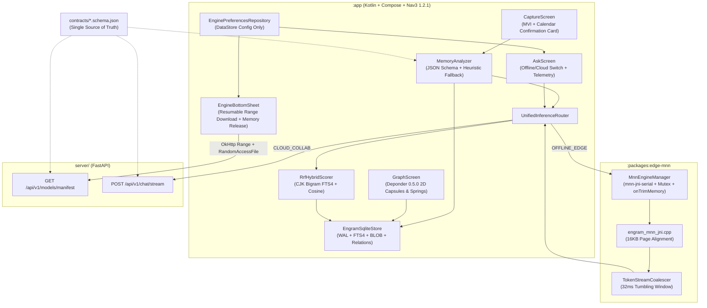
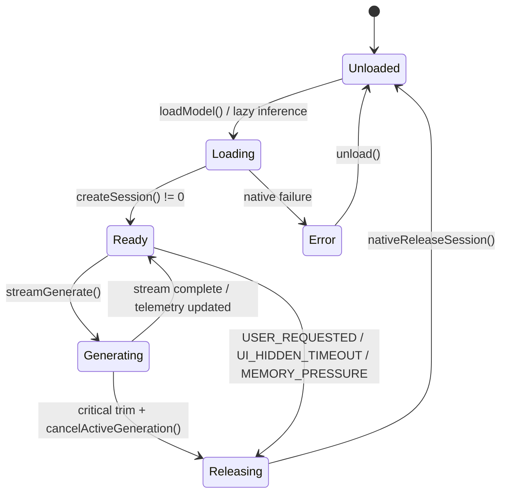

# Engram System Architecture

## 1. End-to-End Monorepo Data Flow

---

## 2. Edge Runtime Lifecycle & Native Memory State Machine

All calls to native handles execute sequentially on `mnn-jni-serial` protected by a Kotlin coroutine `Mutex`. `EngramApplication.onTrimMemory` drives automatic background reclamation:

### Memory Trim Policy
- `TRIM_MEMORY_UI_HIDDEN (20)`: Schedules deferred `unload(UI_HIDDEN_TIMEOUT)` after `15s` grace window; cancelled automatically if the user resumes inference.
- `TRIM_MEMORY_RUNNING_CRITICAL (15)` or `level >= TRIM_MEMORY_BACKGROUND (40)`: Immediately signals `nativeRequestCancel(handle)` and dispatches `unload(MEMORY_PRESSURE)`.

---

## 3. Hybrid Local RAG Formula (`CJK Bigram + Vector RRF`)

1. **Lexical Branch (`SQLite FTS4`)**: `CjkBigramTokenizer` emits overlapping 2-character CJK shingles (`"采购合同"` -> `"采购" "购合" "合同"`) alongside lowercased ASCII word tokens, using prefix queries (`"张*"`) for single-character CJK lookups.
2. **Semantic Branch (`FloatArray BLOB`)**: L2-normalized embeddings are stored in `memory_embeddings` and scored via cosine dot product in memory (`< 2ms` up to 10k personal notes without native vector index dependencies).
3. **Reciprocal Rank Fusion (`k = 60`)**:

$$\text{RRF}(d) = \frac{1}{60 + \text{rank}_{\text{fts}}(d)} + \frac{1}{60 + \text{rank}_{\text{vec}}(d)}$$

---

## 4. Deponder 0.5.0 Graph Invariants

Before passing triples into `DeponderDefaultRubber` / `Modifier.deponderPlanet`, `MemoryAnalyzer.sanitizeRelations` guarantees:
1. Unique non-blank entity IDs under `deponderRoot`.
2. Zero self-loops (`source != target`).
3. At most one edge per unordered pair `(min(a,b), max(a,b))`, automatically merging opposing `(A -> B)` and `(B -> A)` pairs into `DeponderArrowMode.BOTH`.
