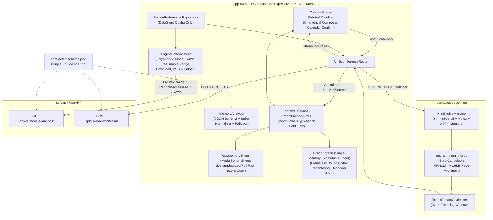
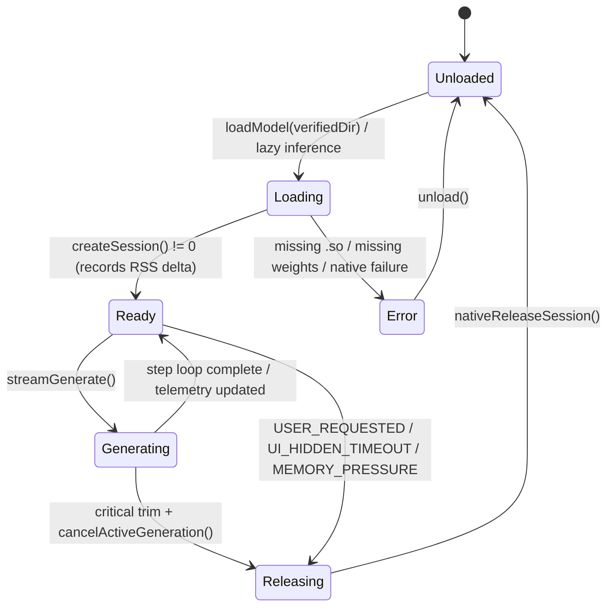

# Engram System Architecture

## 1. End-to-End Monorepo Data Flow

---

## 2. Edge Runtime Lifecycle & Native Memory State Machine

All calls to native handles execute sequentially on `mnn-jni-serial` protected by a Kotlin coroutine `Mutex`. Without prebuilt `libMNN.so` / `libllm.so` (`isBackendAvailable == false`) or verified local weights, `MnnEngineManager.loadModel` rejects the request with `EngineState.Error` instead of faking `Ready`. `EngramApplication.onTrimMemory` drives automatic background reclamation:

### Memory Accounting & Trim Policy
- **Process RSS (`AndroidMemoryProvider`)**: Reads `/proc/self/statm` resident pages multiplied by `Os.sysconf(_SC_PAGESIZE)` so `MNN_LOW_MEMORY` `mmap`-backed weights are reflected accurately on both 4KB and 16KB page-size devices.
- **`TRIM_MEMORY_UI_HIDDEN (20)`**: Schedules deferred `unload(UI_HIDDEN_TIMEOUT)` after `15s` grace window; cancelled automatically if the user resumes inference.
- **`TRIM_MEMORY_RUNNING_CRITICAL (15)`** or **`level >= TRIM_MEMORY_BACKGROUND (40)`**: Immediately sets `cancel_requested` (halting `Llm::generate(1)` on the next token step) and dispatches `unload(MEMORY_PRESSURE)`.

---

## 3. Single-Memory Frameless Sheet, Gesture Isolation & Deponder 0.5.0 Invariants

1. **Two-Stage Frameless `GraphSheet` (`BottomSheetSceneStrategy`)**: Opens strictly bound to a single `memoryId` at `50%` `PartiallyExpanded`, supports dragging or single-tapping the `48dp` `DragHandle` to toggle `92%` `Expanded`, and places the sheet-level close (`✕`) action cleanly inside the top `dragHandle` bar without duplicating card summaries, tabs, or inner border rectangles.
2. **Dynamic Vertical Recentering (`Δheight / 2`)**: `GraphScreen` measures height transitions inside `deponderRoot`'s `onSizeChanged` and shifts every node's vertical coordinate by `Δheight / 2`, keeping the force-directed layout centered across `50% <-> 92%` height changes and inline entity citation toggles.
3. **Canvas Gesture Isolation**: A sibling background drag absorber and `NestedScrollConnection` inside `GraphScreen` consume missed drags on empty canvas without intercepting node-level `.deponderDrag()`, preventing accidental sheet dismissal while keeping handle drags responsive.
4. **Graph Invariants (`MemoryAnalyzer.sanitizeRelations`)**:
   - Unique non-blank entity IDs under `deponderRoot`.
   - Zero self-loops (`source != target`).
   - At most one edge per unordered pair `(min(a,b), max(a,b))`, automatically merging opposing `(A -> B)` and `(B -> A)` pairs into `DeponderArrowMode.BOTH`.

---

## 4. Capture UI & Window-Inset Discipline

1. **Summary-First Cards & De-emphasized Raw Text**: Timeline cards have no title and format multi-point AI summaries as concise `\n`-separated `• ` bullets without noisy seed/fallback card badges. Raw note text never expands inline and opens lazily via `RawMemorySheet`.
2. **Symmetrical Composer & Zero Double Insets**: `NavDisplay` calls `consumeWindowInsets(innerPadding)` after `padding(innerPadding)` so `imePadding()` never double-counts bottom system bars; the composer embeds an optically centered `ArrowUpward` submit button inside a symmetrical container and dismisses IME on scroll or blank/card tap.
