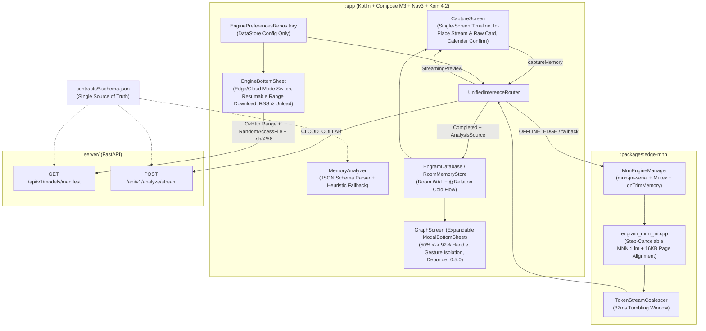
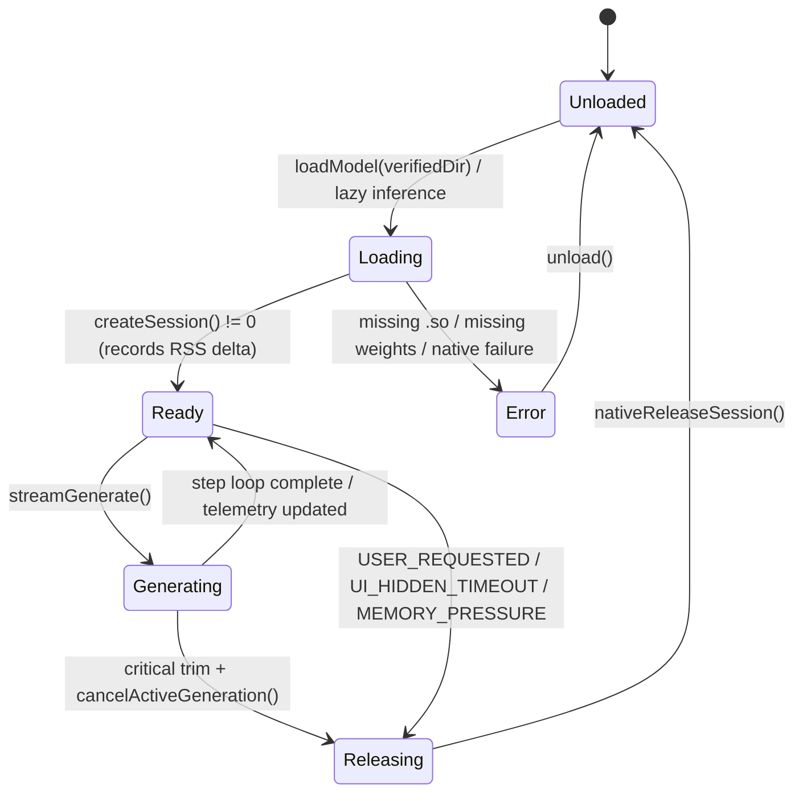

# Engram System Architecture

## 1. End-to-End Monorepo Data Flow

---

## 2. Edge Runtime Lifecycle & Native Memory State Machine

All calls to native handles execute sequentially on `mnn-jni-serial` protected by a Kotlin coroutine `Mutex`. Without prebuilt `libMNN.so` / `libllm.so` (`isBackendAvailable == false`) or verified local weights, `MnnEngineManager.loadModel` rejects the request with `EngineState.Error` instead of faking `Ready`. `EngramApplication.onTrimMemory` drives automatic background reclamation:

### Memory Accounting & Trim Policy
- **Process RSS (`AndroidMemoryProvider`)**: Reads `/proc/self/statm` resident pages multiplied by `Os.sysconf(_SC_PAGESIZE)` so `MNN_LOW_MEMORY` `mmap`-backed weights are reflected accurately on both 4KB and 16KB page-size devices.
- **`TRIM_MEMORY_UI_HIDDEN (20)`**: Schedules deferred `unload(UI_HIDDEN_TIMEOUT)` after `15s` grace window; cancelled automatically if the user resumes inference.
- **`TRIM_MEMORY_RUNNING_CRITICAL (15)`** or **`level >= TRIM_MEMORY_BACKGROUND (40)`**: Immediately sets `cancel_requested` (halting `Llm::generate(1)` on the next token step) and dispatches `unload(MEMORY_PRESSURE)`.

---

## 3. Expandable Sheet Gesture Isolation & Deponder 0.5.0 Invariants

1. **Two-Stage Sheet (`BottomSheetSceneStrategy`)**: Opens at `50%` `PartiallyExpanded`, supports dragging or single-tapping the `48dp` `DragHandle` to toggle `92%` `Expanded`, and provides a close button when expanded alongside system Predictive Back.
2. **Canvas Gesture Isolation**: A sibling background drag absorber and `NestedScrollConnection` inside `GraphScreen` consume missed drags on empty canvas without intercepting node-level `.deponderDrag()`, preventing accidental sheet dismissal while keeping header/handle drags responsive.
3. **Graph Invariants (`MemoryAnalyzer.sanitizeRelations`)**:
   - Unique non-blank entity IDs under `deponderRoot`.
   - Zero self-loops (`source != target`).
   - At most one edge per unordered pair `(min(a,b), max(a,b))`, automatically merging opposing `(A -> B)` and `(B -> A)` pairs into `DeponderArrowMode.BOTH`.
